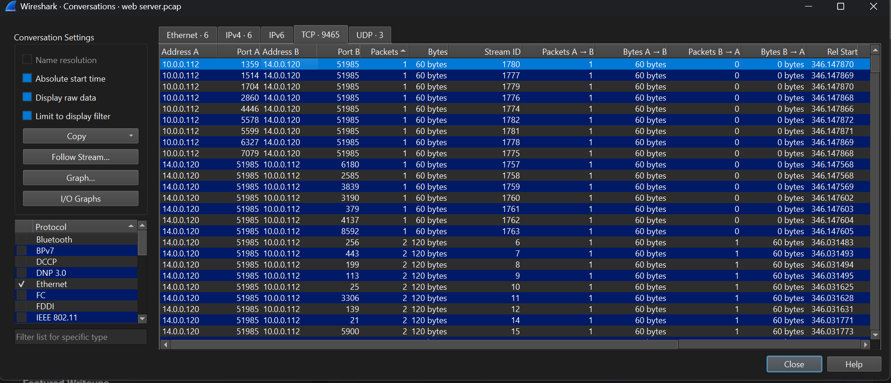

# Question 1: Identifying the Source IP Address

## Objective
Identify the IP address responsible for initiating suspicious requests against the Apache Tomcat web server.

## Tool:
- Wireshark

## Investigation Methodology

1. Opened the PCAP file in Wireshark.
2. Navigated to **Statistics → Conversations**.
3. Selected the IPv4 tab to examine communication between hosts.
4. Reviewed the source and destination IP addresses involved in the captured network traffic.
5. Identified the IP address responsible for initiating the suspicious requests.

## Finding

- **Source IP:** `14.0.0.120`

## Security relevance

The Conversations feature provides an overview of communication between network endpoints, including packet counts and transferred bytes. This helps analysts identify hosts generating significant or unusual traffic.

In this investigation, it provided an initial lead for identifying the host responsible for suspicious requests against the web server.

## Evidence

