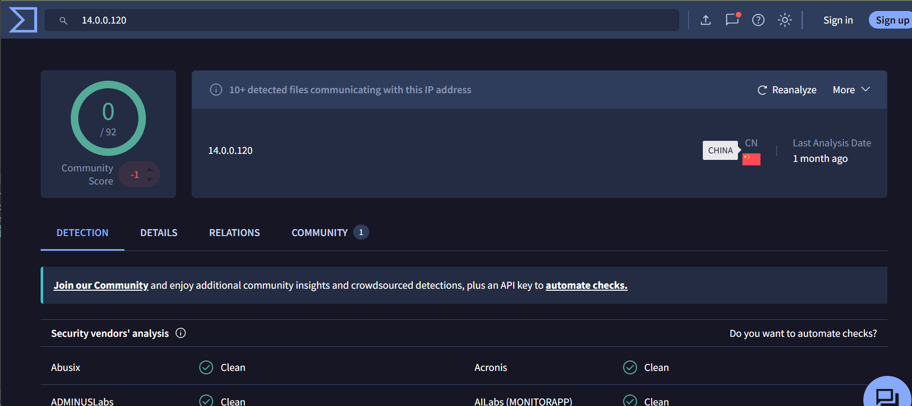

# Question 2: Identifying the Attacker's Country of Origin

## Objective
Determine the geographical origin associated with the suspicious IP address identified during the initial network traffic investigation.

## Tool Used
- VirusTotal

## Investigation Methodology

1. Opened VirusTotal's IP address intelligence platform.
2. Searched for the previously identified IP address: `14.0.0.120`.
3. Examined the available IP address intelligence and geographical information.
4. Identified the country associated with the IP address.

## Finding

- **IP Address:** `14.0.0.120`
- **Reported Country:** China

## Security Relevance

Geolocation information can provide additional context during threat intelligence investigations. By enriching suspicious IP addresses with external intelligence sources, SOC analysts can gain insight into the geographical information associated with potentially malicious infrastructure.

However, IP geolocation does not conclusively establish the physical location or identity of an attacker. VPNs, proxies, compromised systems and hosting infrastructure can affect attribution.

## Evidence

