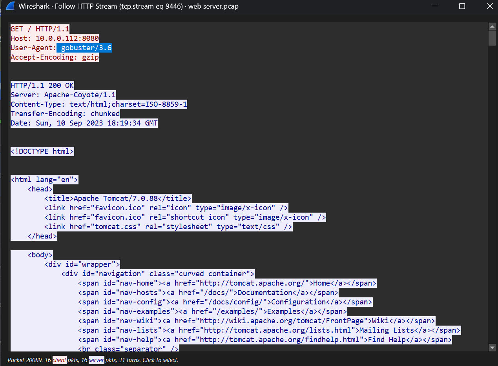

# Question 4: Identifying the Directory Enumeration Tool

## Objective

Identify the tool used by the attacker to enumerate directories and files on the Apache Tomcat web server.

## Tool Used for Analysis

- Wireshark

## Identified Attacker Tool

- Gobuster

## Investigation Methodology

While examining the captured HTTP traffic in Wireshark, I observed multiple requests targeting different directories and files on the web server.

A recurring pattern of HTTP `404 Not Found` responses was visible, suggesting that the attacker was systematically attempting to discover accessible resources.

To investigate further, I selected relevant HTTP packets and used **Follow → HTTP Stream** to reconstruct and inspect the HTTP communication.

By examining the requests and associated information within the HTTP stream, I was able to identify Gobuster as the directory enumeration tool used by the attacker.

## Findings

- **Identified Tool:** Gobuster
- **Attack Technique:** Web directory and file enumeration
- **Observed Behaviour:** Repeated HTTP requests to different resource paths.
- **Server Responses:** Multiple HTTP 404 Not Found responses.

## Security Relevance

Gobuster is a legitimate security testing tool commonly used for directory and file enumeration. However, attackers can also use it during reconnaissance to discover hidden directories, administrative interfaces, backup files and other potentially exposed resources.

Repeated requests to different web server paths, particularly when accompanied by numerous unsuccessful responses, can provide indicators of automated enumeration activity.

SOC analysts can investigate these patterns using HTTP request logs, PCAP analysis and SIEM correlation to identify potential reconnaissance activity.

## Evidence

