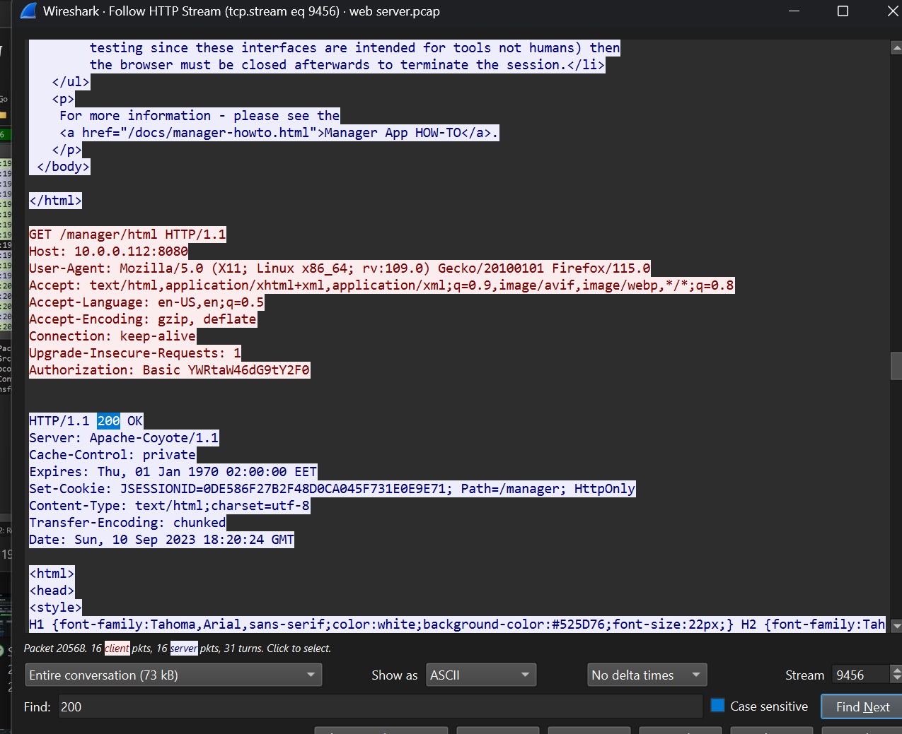
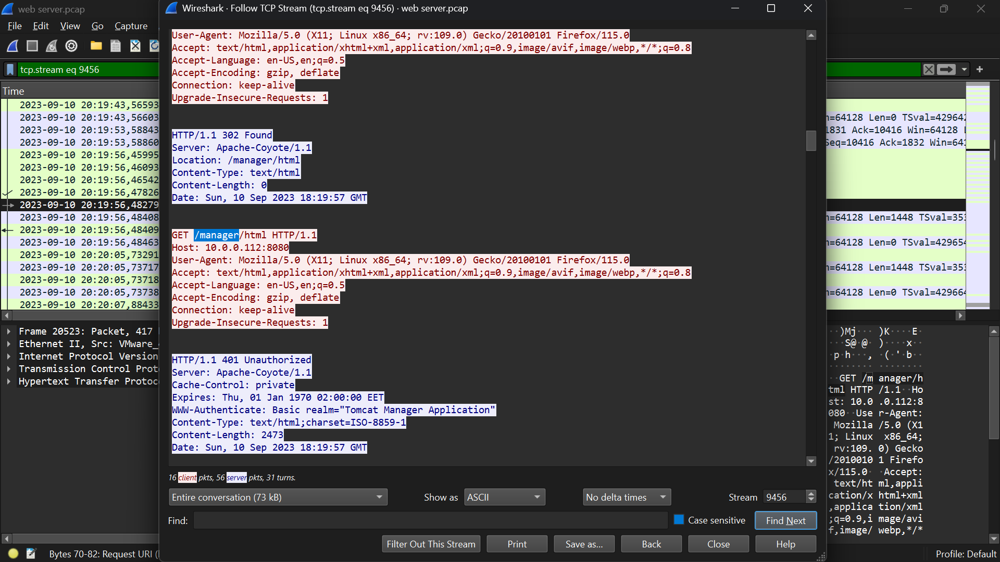

# Question 5: Identifying the Discovered Admin Directory

## Objective

Identify the administrative directory discovered by the attacker during the web server enumeration process.

## Tool Used

- Wireshark

## Investigation Methodology

Following the identification of Gobuster as the directory enumeration tool, I continued analyzing the captured HTTP traffic to determine which administrative resources the attacker discovered.

I inspected the HTTP requests and used **Follow → HTTP Stream** to reconstruct the communication between the attacker and the Apache Tomcat web server.

During the investigation, I identified an HTTP request targeting the following directory:

`/manager`

The corresponding server response contained the HTTP status code `200 OK`.

## Finding

- **Discovered Directory:** `/manager`
- **HTTP Response:** `200 OK`

## Analysis

The HTTP 200 OK response indicates that the server successfully processed the request to the `/manager` directory.

This suggests that the directory was accessible at the HTTP level and was successfully identified during the attacker's enumeration activity.

However, a successful HTTP response does not necessarily establish that the attacker obtained authenticated administrative access.

## Security Relevance

Administrative interfaces should not be unnecessarily exposed to untrusted networks.

The discovery of the `/manager` directory highlights the importance of restricting access to administrative resources through network segmentation, access controls and strong authentication mechanisms.

SOC analysts should investigate subsequent requests to determine whether the attacker attempted authentication or accessed sensitive administrative functionality.

## Evidence

